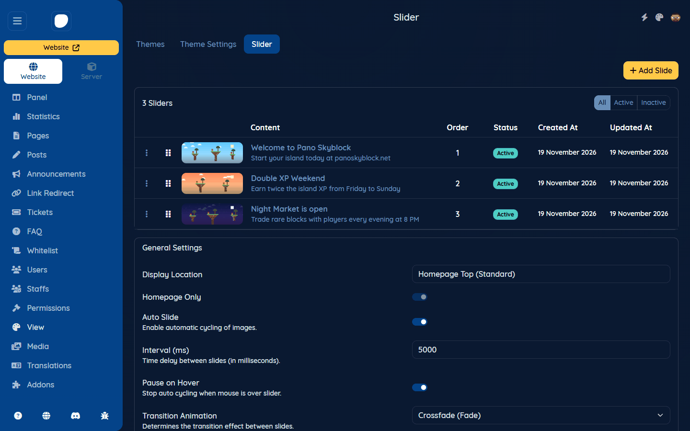

  
  <h1>Slider</h1>
  
<b>Greet your visitors with a big, eye-catching image slider.</b>

  

    
    
    
  

Slider adds a large image slider to the top of your Pano home page. Show your latest event, a store sale or how to join, each with its own title, text and link, and let the slides change on their own.

<h3 align="center">Features</h3>

- 🖼️ **Image slides**: Upload an image and add a title, text and a link to each slide.
- 🔀 **Drag to reorder**: Change the order of your slides in the panel.
- ▶️ **Auto play**: Slides change on their own and pause when a visitor hovers over them.
- ✨ **Smooth transitions**: Choose how slides change, like a soft fade.
- 🎯 **Arrows and dots**: Let visitors flip through the slides themselves.
- 🎨 **Caption styles**: Pick text colors and the caption background to match your site.
- ⏸️ **Active or inactive**: Prepare slides early and switch them on when you need them.

<h3 align="center">Screenshots</h3>

<i>Manage your slides and the slider settings on one page.</i>

<h3 align="center">Get started</h3>

1. Open your Pano panel and go to **Addons**.
2. Find **Slider** and click **Install**.
3. Open **View → Slider** in the panel and click **Add Slide**.

<h3 align="center">Support</h3>

Questions or ideas? Join our [Discord](https://panomc.com/discord) or visit [panomc.com](https://panomc.com).

<h3 align="center">License</h3>

Released under the MIT License.
